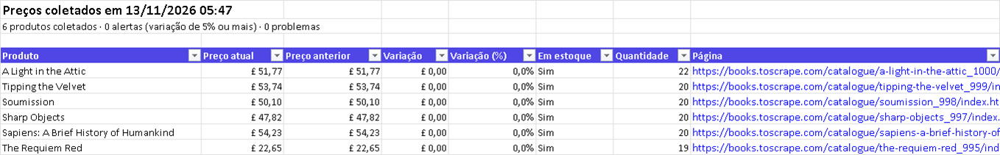
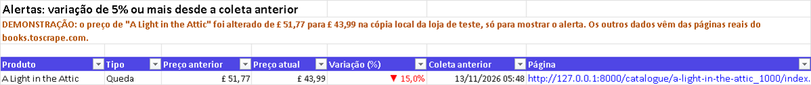

# Monitor de preços da concorrência

[](https://github.com/artvsantos/monitor-precos/actions/workflows/ci.yml)

Quem vende online precisa saber o preço do concorrente, para não ficar caro
demais nem barato à toa. Na prática, alguém abre site por site, produto por
produto, e anota numa planilha, quando sobra tempo. Aí o concorrente baixa o
preço numa terça e você só percebe quando as vendas caem.

Este monitor faz essa ronda sozinho. Ele lê a lista de produtos, visita a
página de cada um, guarda o preço num histórico e monta uma planilha em
Excel com o preço atual, quanto ele mudou desde a última coleta e uma aba de
alertas com o que subiu ou caiu além do limite que você escolher.

## Antes e depois

| Antes | Com o monitor |
| --- | --- |
| Abrir site por site e copiar cada preço | Um comando coleta todos, e dá para agendar |
| Planilha montada à mão, sem histórico | Cada coleta fica guardada num banco SQLite |
| Descobrir a mudança de preço dias depois | A aba **Alertas** mostra o que subiu ou caiu 5% ou mais (ou o limite que você escolher) |
| Página fora do ar some da conta sem ninguém ver | A aba **Problemas** diz o que não deu para coletar e por quê |

## A planilha



Essa é a [`exemplos/precos.xlsx`](exemplos/precos.xlsx), de duas coletas de
verdade no books.toscrape.com, um site feito para treinar coleta de dados.
Os preços estão em libras porque é a moeda do site; numa loja brasileira,
apareceriam em reais.

| Aba | O que tem |
| --- | --- |
| **Preços** | Cada produto com o preço atual, o da coleta anterior, a variação em valor e em %, o estoque e o link |
| **Alertas** | Só o que mudou além do limite, do maior para o menor, dizendo se foi queda ou alta |
| **Histórico** | Todos os preços de todas as coletas, para filtrar ou fazer gráfico |
| **Problemas** | O produto que não deu para coletar e o motivo: página fora do ar, layout mudou, robots.txt proíbe... |

## Demonstração do alerta, numa loja de teste

O books.toscrape.com tem preços fixos: entre duas coletas reais nada muda, e
é por isso que a `precos.xlsx` não tem nenhum alerta. Para mostrar o alerta
funcionando, o projeto traz uma **loja de teste**: uma cópia de três páginas
de produto do [books.toscrape.com](https://books.toscrape.com), que é a fonte
delas, em [`exemplos/loja-de-teste`](exemplos/loja-de-teste). O próprio
Python serve essa cópia no seu computador.



**A [`exemplos/demonstracao-alerta.xlsx`](exemplos/demonstracao-alerta.xlsx)
é uma demonstração.** Entre as duas coletas, o preço de "A Light in the
Attic" foi alterado de £ 51,77 para £ 43,99 na cópia local da loja de teste,
só para mostrar o alerta. Os outros dados vêm das páginas copiadas, sem
mudança. A planilha avisa isso no topo das abas Preços e Alertas.

Para fazer você mesmo, com dois terminais abertos na pasta do projeto:

1. No primeiro, sirva a loja de teste:
   ```bash
   python -m http.server 8000 --bind 127.0.0.1 --directory exemplos/loja-de-teste
   ```
2. No segundo, faça a primeira coleta:
   ```bash
   venv\Scripts\python -m monitor_precos rodar --produtos exemplos\produtos-loja-de-teste.csv --banco demonstracao.db --saida demonstracao.xlsx
   ```
3. Abra `exemplos/loja-de-teste/catalogue/a-light-in-the-attic_1000/index.html`
   num editor de texto e troque `£51.77` por `£43.99` na linha
   `<p class="price_color">`.
4. Rode o comando do passo 2 de novo. A aba Alertas da `demonstracao.xlsx`
   mostra a queda de 15%.
5. Para voltar o preço original: `git checkout exemplos/loja-de-teste`.

O [`exemplos/gerar_exemplos.py`](exemplos/gerar_exemplos.py) faz as duas
planilhas de exemplo sozinho; na demonstração, ele muda o preço numa cópia
temporária da loja, sem mexer na pasta do projeto.

## Coleta com educação

Os exemplos e os testes usam só o books.toscrape.com, uma livraria de mentira
feita para quem quer treinar coleta de dados. Nenhuma loja de verdade foi
visitada. Em qualquer site, o monitor coleta do jeito certo:

- **Respeita o robots.txt.** Ele lê o arquivo de cada site e não visita o que
  ele proíbe. Se não conseguir ler o arquivo, deixa o site de fora daquela
  coleta.
- **Não sobrecarrega o site.** Espera pelo menos 1 segundo entre os pedidos
  ao mesmo site (2, por padrão), ou mais, se o robots.txt pedir
  (`Crawl-delay`).
- **Diz quem é.** Ele se identifica como robô (`monitor-precos/1.0`), sem
  fingir ser um navegador.
- **Busca só o necessário.** Pega nome, preço e estoque de páginas públicas,
  sem login.

Para usar em outra loja, leia antes os termos de uso e o robots.txt do site,
e escreva o leitor da página dela. Cada site organiza o HTML de um jeito, e o
monitor recusa a página que não reconhece, em vez de inventar um preço. O
modelo é o [`books_toscrape.py`](monitor_precos/coleta/books_toscrape.py).

## Como usar

Precisa do Python 3.12 ou mais novo:

```bash
python -m venv venv
venv\Scripts\pip install -r requirements.txt     # Linux/Mac: venv/bin/pip
venv\Scripts\python -m monitor_precos rodar --produtos exemplos\produtos.csv
```

```
Coletando 6 produtos de exemplos\produtos.csv, com pausa de 2 s entre os pedidos a cada site
  A Light in the Attic: £ 51,77
  Tipping the Velvet: £ 53,74
  Soumission: £ 50,10
  Sharp Objects: £ 47,82
  Sapiens: A Brief History of Humankind: £ 54,23
  The Requiem Red: £ 22,65

Histórico em historico.db
Planilha salva em precos.xlsx
6 produtos coletados · 0 alertas (variação de 5% ou mais) · 0 problemas
```

A lista de produtos é um CSV com um endereço por linha, na coluna `url`
([exemplo](exemplos/produtos.csv)). Pode ter outras colunas, como um apelido
para o produto, e pode ser salva pelo Excel, com ponto e vírgula. Linhas que
começam com `#` são ignoradas.

| Opção | Para que serve | Padrão |
| --- | --- | --- |
| `--produtos` | A lista de produtos | `produtos.csv` |
| `--banco` | Onde fica o histórico | `historico.db` |
| `--saida` | Onde salvar a planilha | `precos.xlsx` |
| `--alerta` | Variação, em %, que vira alerta | `5` |
| `--intervalo` | Segundos de pausa entre os pedidos ao mesmo site (mínimo 1) | `2` |
| `--aviso` | Uma linha de texto no topo da planilha | |

## Rodar todo dia, sozinho

**Windows (Agendador de Tarefas).** Em "Criar Tarefa Básica", escolha
"Diariamente" e o horário. Na ação "Iniciar um programa", use o
`venv\Scripts\python.exe` do projeto como programa, `-m monitor_precos rodar`
como argumentos e a pasta do projeto em "Iniciar em". Ou, no terminal:

```bash
schtasks /Create /SC DAILY /ST 08:00 /TN "Monitor de precos" /TR "cmd /c cd /d C:\monitor-precos && venv\Scripts\python -m monitor_precos rodar >> coleta.log 2>&1"
```

**Linux ou Mac (cron).** Com `crontab -e`, a linha abaixo coleta todo dia às
8h e guarda o que aconteceu no `coleta.log`:

```bash
0 8 * * * cd /home/voce/monitor-precos && venv/bin/python -m monitor_precos rodar >> coleta.log 2>&1
```

Se a planilha estiver aberta no Excel na hora da coleta, o monitor avisa e
essa coleta não entra no histórico: assim a variação do dia aparece na
próxima planilha, em vez de se perder. O código de saída é 1 quando nenhum
produto foi coletado ou a planilha não pôde ser salva, para o agendador
marcar a execução como falha.

## Como funciona

```
monitor_precos/
├── coleta/          a lista de produtos, o cliente HTTP educado e o leitor da página
├── armazenamento/   o histórico no SQLite e a comparação com a coleta anterior
├── relatorio/       os alertas e a planilha (openpyxl)
└── cli.py           python -m monitor_precos rodar
```

Algumas decisões:

- **Preço em centavos**, como número inteiro, para não perder centavo em
  conta com número quebrado.
- **O leitor recebe bytes, não texto.** O site de treino não diz a
  codificação no cabeçalho HTTP; lida como texto pelo `requests`, a libra
  viraria "£". O BeautifulSoup lê o `<meta charset>` da página.
- **Um produto com erro não para os outros.** Ele vira uma linha na aba
  Problemas, com o motivo.
- **A coleta anterior é a última que deu certo.** Se o site ficou fora do ar
  num dia, a comparação seguinte usa o preço do dia anterior a ele.

## Testes

```bash
venv\Scripts\pip install -r requirements-dev.txt
venv\Scripts\pytest --cov
```

Feito com TDD, com 100% de cobertura. Nenhum teste usa a internet: as
páginas são cópias salvas do books.toscrape.com, o site é falso e o relógio
também, para testar a pausa entre os pedidos sem esperar de verdade. O alerta
é testado de ponta a ponta na loja de teste, servida em `127.0.0.1`. O CI
roda no Windows e no Linux, do Python 3.12 ao 3.14.

## Feito com

Python · requests · BeautifulSoup · SQLite · openpyxl · pytest · ruff ·
GitHub Actions

---

Precisa acompanhar preços ou coletar dados de sites para a sua empresa? Fale
comigo pelo [LinkedIn](https://www.linkedin.com/in/arthurvieira-dev) ou pelo
e-mail arthursantos334@gmail.com.
